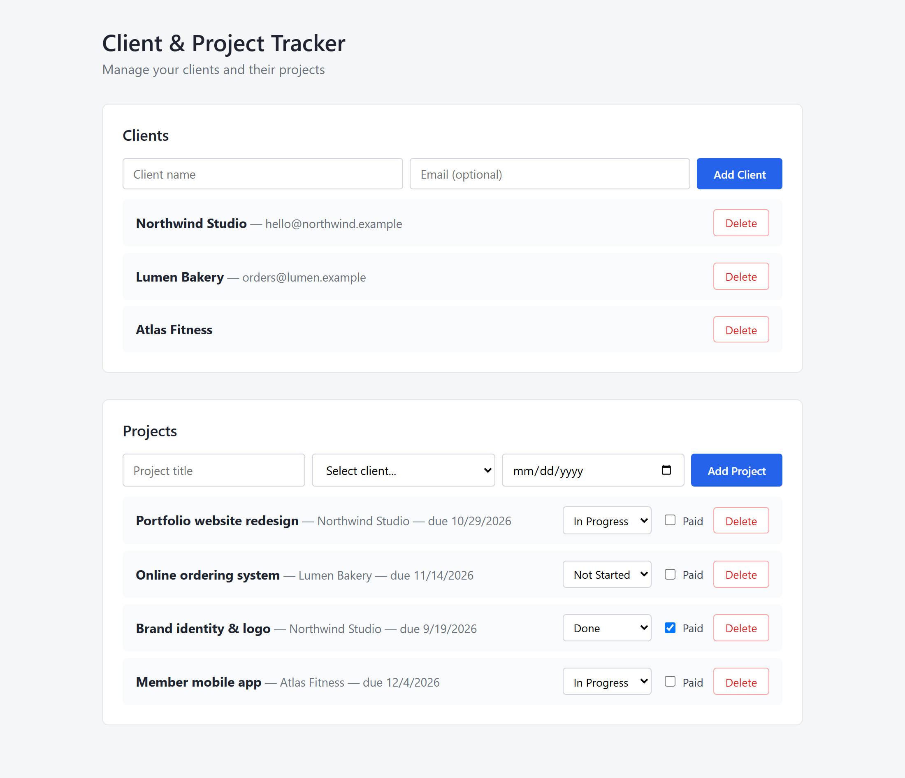
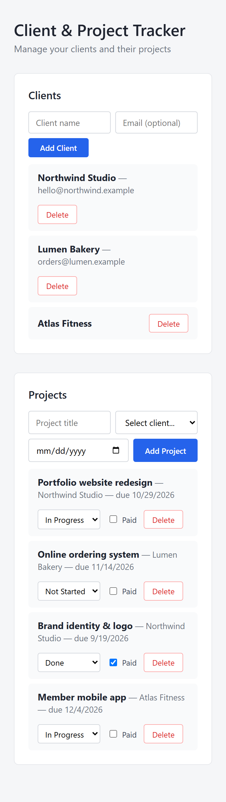
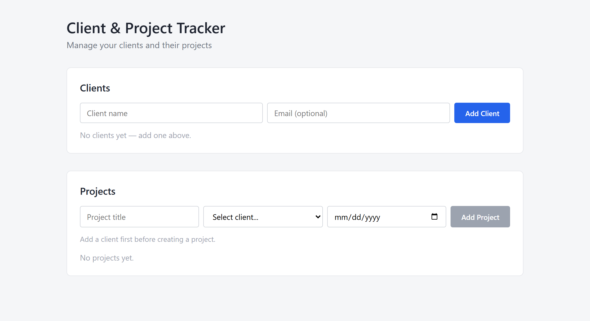

# Client & Project Tracker

A full-stack web app for freelancers to keep track of their clients and the projects they are working on: deadlines, progress status and whether a project has been paid.



> **How it was built:** I built this project as a learning exercise, working together with [Claude](https://claude.ai) (Anthropic's AI assistant) as a pair-programming partner and tutor. I used it to learn how a full-stack app fits together, to review my code and to debug problems, and I made sure I understand every part of the result.

## Features

- Add and delete clients (name + optional email)
- Create projects linked to a client, with an optional deadline
- Update project status (**Not Started / In Progress / Done**) and toggle **Paid** directly from the list
- Server-side validation and meaningful HTTP errors (400 / 404 / 409) shown to the user
- A client that still has projects cannot be deleted (protects data integrity)
- Responsive layout (works on mobile)

<p>
  
  
</p>

## Tech stack

| Layer    | Technology                                   |
| -------- | -------------------------------------------- |
| Frontend | React 18, Vite, plain CSS                    |
| Backend  | Node.js, Express 5, REST API                 |
| Database | PostgreSQL (hosted on Neon) via Prisma ORM   |

## Project structure

```
backend/    Express API + Prisma schema and migrations
frontend/   React + Vite client
docs/       Screenshots used in this README
```

## Getting started

You need Node.js 18+ and a PostgreSQL database (a free [Neon](https://neon.tech) project works well).

### 1. Backend

```bash
cd backend
npm install                 # also runs `prisma generate`
cp .env.example .env        # then put your PostgreSQL connection string in DATABASE_URL
npx prisma migrate deploy   # creates the tables
npm run dev
```

The API runs on `http://localhost:3000`.

| Variable       | Required | Description                                              |
| -------------- | -------- | -------------------------------------------------------- |
| `DATABASE_URL` | yes      | PostgreSQL connection string                             |
| `CORS_ORIGIN`  | no       | Comma-separated allowed frontend origins (default: all)  |
| `PORT`         | no       | Port for the API (default: 3000)                         |

### 2. Frontend

```bash
cd frontend
npm install
cp .env.example .env        # VITE_API_URL points to the backend
npm run dev
```

The app runs on `http://localhost:5173`.

## API reference

| Method | Endpoint        | Description                       |
| ------ | --------------- | --------------------------------- |
| GET    | `/clients`      | List all clients                  |
| POST   | `/clients`      | Create a client                   |
| PUT    | `/clients/:id`  | Update a client                   |
| DELETE | `/clients/:id`  | Delete a client (409 if it has projects) |
| GET    | `/projects`     | List all projects (with client)   |
| POST   | `/projects`     | Create a project                  |
| PUT    | `/projects/:id` | Update a project                  |
| DELETE | `/projects/:id` | Delete a project                  |

Errors are returned as JSON: `{ "error": "message" }` with status `400` (validation), `404` (not found), `409` (conflict) or `500`.

## Possible improvements

- Authentication so each user sees only their own clients
- Editing clients, filtering/sorting projects, pagination
- Automated tests (API + components)
- Deployment (frontend on Vercel, API on Render)
